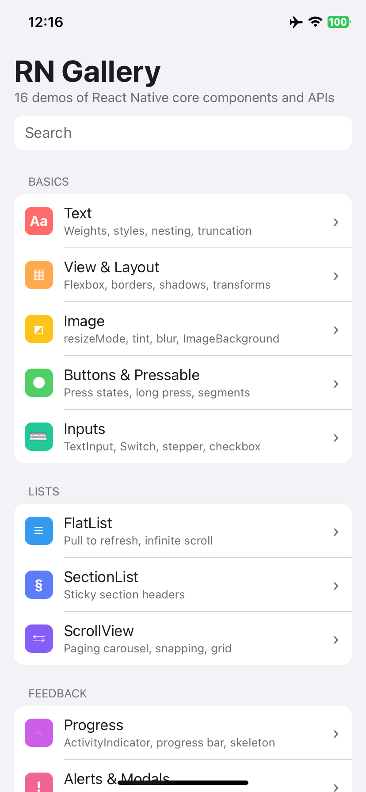
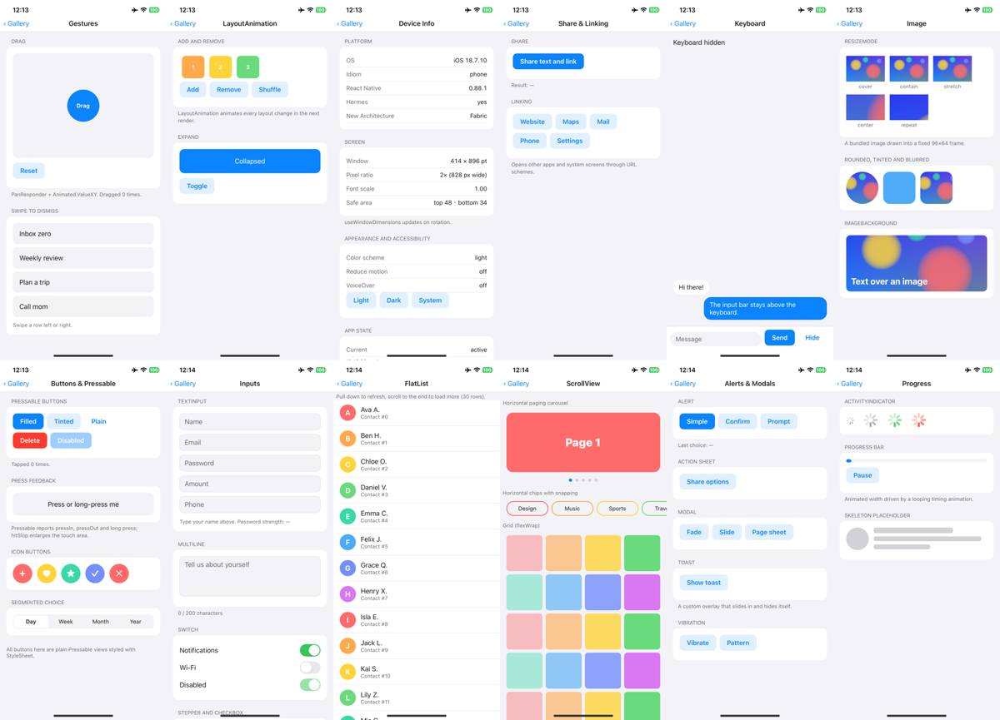

<div align="center">

# React Native Gallery

**English** · [简体中文](README_zh.md)

16 interactive demos of React Native's built-in components and APIs: text and layout, images, buttons, inputs, lists, alerts and modals, animation, gestures and device APIs.<br/>
No third-party UI library: everything is plain React Native, so each screen shows how the core API itself is used.<br/>
Builds and runs on iPhone from Windows, Linux or macOS with [KXBuild](https://github.com/kxbuild/kxbuild).



</div>

## What's inside

| Section | Demo | Shows |
|---|---|---|
| **Basics** | Text | Font weights and styles, nested text, `numberOfLines` truncation, selectable text |
| | View & Layout | Flexbox direction and `justifyContent`, borders, radius, shadows, transforms, absolute positioning |
| | Image | Every `resizeMode`, rounded / tinted / blurred images, `ImageBackground` |
| | Buttons & Pressable | Press, long press and pressed states, `hitSlop`, icon buttons, a segmented control |
| | Inputs | `TextInput` keyboards and secure entry, multiline with a counter, `Switch`, stepper, checkboxes |
| **Lists** | FlatList | Pull to refresh with `RefreshControl`, infinite scrolling |
| | SectionList | Sticky section headers |
| | ScrollView | Paging carousel with page dots, snapping chips, a wrapping grid |
| **Feedback** | Progress | `ActivityIndicator`, an animated progress bar, a skeleton placeholder |
| | Alerts & Modals | `Alert` (confirm, prompt), `ActionSheetIOS`, `Modal` (fade, slide, page sheet), a toast, `Vibration` |
| **Motion** | Animated | Easing curves, spring, spin, stagger, all on the native driver |
| | Gestures | Drag with `PanResponder`, swipe to dismiss |
| | LayoutAnimation | Animated add / remove / shuffle and expand |
| **Device** | Device Info | Platform and React Native version, Hermes, Fabric, screen metrics, safe area, appearance, accessibility settings, `AppState` |
| | Share & Linking | Share sheet, opening websites, Maps, Mail, Phone and Settings |
| | Keyboard | `KeyboardAvoidingView` chat input, keyboard show / hide events |

The home screen has search, and the whole app follows the system light / dark mode.



## Run it on an iPhone

You need Node.js, KXBuild installed ([install guide](https://github.com/kxbuild/kxbuild#-install)) and [signing](https://github.com/kxbuild/kxbuild#-signing) set up.

```shell
git clone https://github.com/kxbuild/react-native-gallery.git
cd react-native-gallery
npm install

# First build only: prepare the iOS project and install its pods
kxbuild doctor .
cd ios
pod install
cd ..

# Build Release (JavaScript bundled into the app), install on the USB-connected iPhone and launch it
kxbuild run ios/RNGallery.xcworkspace -s RNGallery -c Release
```

The bundle identifier is `com.kxbuild.rngallery`. If your provisioning profile does not cover it, switch to one of yours:

```shell
kxbuild project add-setting --project ios/RNGallery.xcodeproj --target RNGallery --key PRODUCT_BUNDLE_IDENTIFIER --value com.yourcompany.rngallery
```

To open one demo right away, pass its id as a launch argument, for example `--args "-demo animated"`. The ids are in [src/demos/index.ts](src/demos/index.ts).

### Fast Refresh in VS Code

Install the KXBuild extension, open this folder, pick the iPhone in the KXBuild view and press F5. The Debug build loads JavaScript from Metro over the USB cable; save a file and the change appears on the phone right away.

## Project layout

```
App.tsx              home screen with search, and the screen stack
src/demos/           one file per section; index.ts lists every demo
src/ui.tsx           Page, Section, Button and other shared pieces
src/theme.ts         light and dark colors
```

To add a demo, write a component in `src/demos/` and add an entry to `categories` in `src/demos/index.ts`.

## License

MIT. See [LICENSE](LICENSE).
