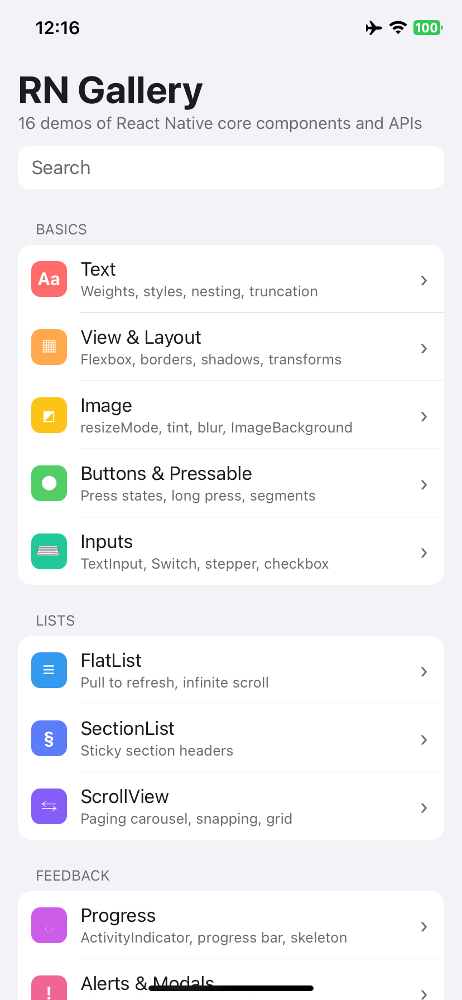
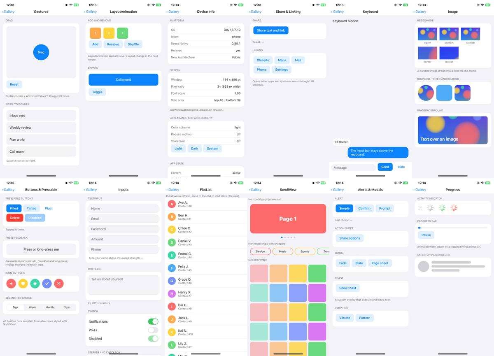

<div align="center">

# React Native Gallery

[English](README.md) · **简体中文**

16 个可交互的示例，覆盖 React Native 内置组件与 API：文本与布局、图片、按钮、输入、列表、对话框与模态框、动画、手势和设备 API。<br/>
不依赖任何第三方 UI 库，全部是原生 React Native 写法，每个页面都直接展示核心 API 的用法。<br/>
在 Windows、Linux、macOS 上用 [KXBuild](https://github.com/kxbuild/kxbuild) 即可编译并安装到 iPhone 上运行。



</div>

## 包含内容

| 分类 | 示例 | 展示内容 |
|---|---|---|
| **基础** | Text | 字重与样式、嵌套文本、`numberOfLines` 截断、可选中文本 |
| | View & Layout | Flexbox 方向与 `justifyContent`、边框、圆角、阴影、变换、绝对定位 |
| | Image | 全部 `resizeMode`、圆角 / 着色 / 模糊图片、`ImageBackground` |
| | Buttons & Pressable | 点击、长按与按下状态、`hitSlop`、图标按钮、分段控件 |
| | Inputs | `TextInput` 各种键盘与密码输入、带计数的多行输入、`Switch`、步进器、复选框 |
| **列表** | FlatList | `RefreshControl` 下拉刷新、无限滚动 |
| | SectionList | 吸顶分组标题 |
| | ScrollView | 带页码点的分页轮播、吸附滚动标签、自动换行网格 |
| **反馈** | Progress | `ActivityIndicator`、动画进度条、骨架屏 |
| | Alerts & Modals | `Alert`（确认、输入框）、`ActionSheetIOS`、`Modal`（淡入、滑入、页面表单）、Toast、`Vibration` |
| **动效** | Animated | 缓动曲线、弹簧、旋转、交错动画，全部使用原生驱动 |
| | Gestures | `PanResponder` 拖拽、滑动删除 |
| | LayoutAnimation | 增删、打乱与展开的布局动画 |
| **设备** | Device Info | 系统与 React Native 版本、Hermes、Fabric、屏幕参数、安全区、外观、辅助功能设置、`AppState` |
| | Share & Linking | 分享面板，打开网站、地图、邮件、电话和设置 |
| | Keyboard | `KeyboardAvoidingView` 聊天输入框、键盘显示 / 隐藏事件 |

首页支持搜索，整个应用跟随系统的浅色 / 深色模式。



## 在 iPhone 上运行

准备：已安装 Node.js 和 KXBuild（[安装说明](https://github.com/kxbuild/kxbuild/blob/main/README_zh.md)），并配置好[签名](https://github.com/kxbuild/kxbuild/blob/main/README_zh.md)。

```shell
git clone https://github.com/kxbuild/react-native-gallery.git
cd react-native-gallery
npm install

# 仅首次编译需要：准备 iOS 工程并安装 Pods
kxbuild doctor .
cd ios
pod install
cd ..

# 编译 Release（JavaScript 打包进应用），安装到 USB 连接的 iPhone 并启动
kxbuild run ios/RNGallery.xcworkspace -s RNGallery -c Release
```

Bundle ID 是 `com.kxbuild.rngallery`。如果你的描述文件不包含它，换成你自己的：

```shell
kxbuild project add-setting --project ios/RNGallery.xcodeproj --target RNGallery --key PRODUCT_BUNDLE_IDENTIFIER --value com.yourcompany.rngallery
```

想启动后直接打开某个示例，把它的 id 作为启动参数传入，例如 `--args "-demo animated"`。全部 id 见 [src/demos/index.ts](src/demos/index.ts)。

### 在 VS Code 里使用 Fast Refresh

安装 KXBuild 扩展，打开本目录，在 KXBuild 视图里选中 iPhone 后按 F5。Debug 版通过 USB 线从 Metro 加载 JavaScript，保存文件后改动立即出现在手机上。

## 目录结构

```
App.tsx              带搜索的首页和页面栈
src/demos/           每个分类一个文件；index.ts 列出全部示例
src/ui.tsx           Page、Section、Button 等公共组件
src/theme.ts         浅色与深色配色
```

新增示例：在 `src/demos/` 里写一个组件，再到 `src/demos/index.ts` 的 `categories` 里加一项。

## 许可证

MIT，见 [LICENSE](LICENSE)。
